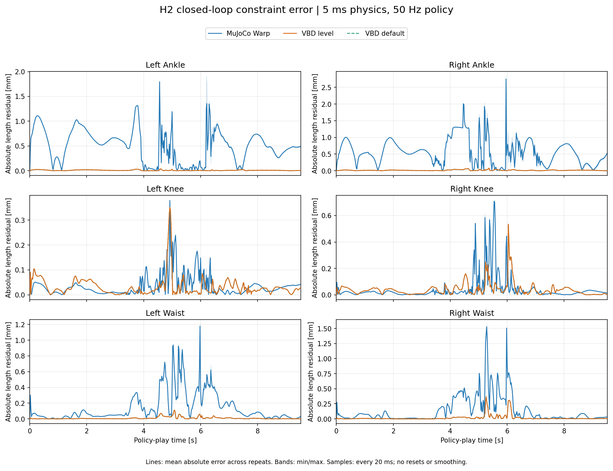

# H2 closed-loop constraint error

Measure geometric loop closure during independent, closed-loop policy play in
mjlab / MuJoCo Warp and Newton VBD. This measures each simulator's internal
constraint satisfaction, not the world-position difference between simulators.

## Metric

For each of the six two-site tendons (left/right ankle, knee and waist), compute
the signed length residual from the actual body-origin poses:

```text
p_a = body_position_a + body_rotation_a * local_site_a
p_b = body_position_b + body_rotation_b * local_site_b
residual = norm(p_b - p_a) - target_length
```

Positive means extension; negative means compression. Raw recordings use meters;
plots and summaries use millimeters. Curves show absolute residuals.

For the H2 XML's constant-length tendon equalities, the target is the compiled
`tendon_length0 + eq_data[0]`, not the length measured at the motion's reset pose.
This follows the [MuJoCo tendon equality definition](https://mujoco.readthedocs.io/en/stable/XMLreference.html#equality-tendon).
The recorder verifies that VBD's two ball-joint anchors on each rigid rod have
the same target length within 1 micrometer. It also checks the mjwarp geometry
against its native `ten_length` after mjlab refreshes forward kinematics.

VBD additionally records the 3D gap at each of the twelve ball-joint anchors:
distance from the parent-link anchor to the corresponding rod anchor. This is
a separate diagnostic: a rod can shift sideways while the distance between
the two link anchors remains correct. It is not directly comparable with a
MuJoCo tendon, which has no simulated rod body.

No FK projection is applied to VBD, no poses are aligned between simulators,
and no extra forward solve is inserted into either play loop.

## Protocol

- Same external checkpoint, motion reference, H2 XML and original PD gains as
  [the sim2sim task](README.md).
- One environment, 476 policy steps / 9.52 s per rollout, three repeats per mode.
- Both: 5 ms physics, decimation 4, 50 Hz policy. VBD: 8 iterations;
  mjwarp: `implicitfast`, Newton solver, maximum 100 iterations / 50 line searches.
- VBD level mode uses the optimized CUDA schedule; default mode is a control.
  Both use the unchanged `BatchH2` CUDA-graph play path.
- Independently evaluate the same actor on each backend's own observations.
  No action replay, perturbations, parameter tuning or trajectory resets.
- Record the initial state and every completed control frame (20 ms).
  This does not measure every 5 ms physics substep; maxima are sampled maxima.
- Exclude the initial state from summary statistics. Do not smooth curves.
  Lines are the mean absolute residual across repeats; bands are min/max,
  not confidence intervals. Runs are repeatability checks, not a robustness study.
- Keep running after tracking thresholds. VBD records the first crossing;
  mjlab terminations are disabled so the entire clip can be compared.

## Reproduce

Results and interpretation are below the reproduction commands.

Use the CUDA environment and external input layout in [README.md](README.md).
The plotting command additionally needs Matplotlib in that environment; this
is an offline analysis dependency, not a Newton runtime requirement.

Run from the repository root, with fresh output filenames:

```sh
H2_PYTHON=../mjlab/.venv/bin/python

uv run --no-project --python "$H2_PYTHON" python -m h2_sim2sim.closure record mjwarp \
  --checkpoint sim2sim_inputs/model_29999.pt --motion sim2sim_inputs/h2_360dankou.npz \
  --steps 476 --repeats 3 --output sim2sim_out/closure/mjwarp.npz

uv run --no-project --python "$H2_PYTHON" python -m h2_sim2sim.closure record vbd \
  --checkpoint sim2sim_inputs/model_29999.pt --motion sim2sim_inputs/h2_360dankou.npz \
  --steps 476 --repeats 3 --level-parallel --output sim2sim_out/closure/vbd_level.npz

uv run --no-project --python "$H2_PYTHON" python -m h2_sim2sim.closure record vbd \
  --checkpoint sim2sim_inputs/model_29999.pt --motion sim2sim_inputs/h2_360dankou.npz \
  --steps 476 --repeats 3 --output sim2sim_out/closure/vbd_default.npz

uv run --no-project --python "$H2_PYTHON" python -m h2_sim2sim.closure plot \
  --mjwarp sim2sim_out/closure/mjwarp.npz --vbd sim2sim_out/closure/vbd_level.npz \
  --vbd-default sim2sim_out/closure/vbd_default.npz \
  --output sim2sim_out/closure/closure_error

uv run --no-project --python "$H2_PYTHON" python -m unittest h2_sim2sim.test_closure
```

Each NPZ contains timestamps, loop names, target lengths, raw world-space
anchors and signed errors, including all repeats. VBD includes ball-anchor
gaps and rod lengths; mjwarp includes native tendon residuals. Companion JSON
files record input hashes, software versions, runtime settings and statistics.
Plotting writes PNG, SVG and a combined JSON summary. Raw runs stay outside Git.

## Results (2026-10-13)

Hardware: NVIDIA RTX PRO 5000 72GB Blackwell. Environment: Warp
1.16.0.dev20260716, Torch 2.9.0+cu128, NumPy 2.5.1, MuJoCo / MuJoCo Warp 3.11.0.
Input hashes match [the benchmark inputs](BENCHMARK.md#input-identity-and-checks).
All nine full rollouts completed and remained finite; none reset during play.

Statistics pool 3 repeats × 476 post-step samples × 6 loops. All values below
are **millimeters**, and the maximum is over the recorded 20 ms samples:

| Backend | Mean absolute | RMS | P95 absolute | Maximum absolute |
|---|---:|---:|---:|---:|
| MuJoCo Warp | 0.236876 | 0.401544 | 0.922483 | 2.837938 |
| VBD level | 0.019622 | 0.039887 | 0.062069 | 0.534216 |
| VBD default | 0.019623 | 0.039888 | 0.062258 | 0.534210 |



The two VBD curves nearly overlap. Their maximum pointwise signed-residual
difference is 0.002418 mm. Repeats within each VBD mode were exactly equal in
this experiment; mjwarp mean absolute error ranged from 0.236741 to 0.237141 mm.
This is not a general determinism guarantee.

| Loop | mjwarp mean absolute | VBD level mean absolute | mjwarp maximum | VBD level maximum |
|---|---:|---:|---:|---:|
| Left ankle | 0.503673 | 0.008574 | 1.910106 | 0.037698 |
| Right ankle | 0.561969 | 0.013829 | 2.837938 | 0.077856 |
| Left knee | 0.034327 | 0.031656 | 0.380104 | 0.351388 |
| Right knee | 0.042490 | 0.039216 | 0.716631 | 0.534216 |
| Left waist | 0.142694 | 0.008835 | 1.202331 | 0.112441 |
| Right waist | 0.136102 | 0.015621 | 1.570153 | 0.366885 |

The largest mjwarp sample is the right ankle at 5.96 s; VBD's is the right knee
at 6.04 s. These timings come from the samples, not fitted or synchronized peaks.
VBD level's twelve ball-anchor gaps have mean 0.009839 mm, RMS 0.019959 mm and
maximum 0.267296 mm. The length residual never exceeds the sum of its two
ball-anchor gaps plus the small rod/target length difference, as geometry requires.

### Interpretation and limits

- Under these settings, VBD has about 12 times lower mean absolute loop-length
  residual and 10 times lower RMS than mjwarp. The largest differences are at
  the ankles and waist; knee averages are much closer, and VBD is not lower at
  every instant.
- This is a comparison of complete play systems, not a matched-stiffness solver
  accuracy contest. mjwarp uses soft tendon equalities (`solref = [0.005, 1]`,
  `solimp = [0.9, 0.95, 0.001, 0.5, 2]`); VBD uses massive rigid rods and two
  ball joints, with constraint stiffness 5e6 and damping 125. The policies also
  generate different actions as their simulated states diverge.
- Smaller loop-length residual does not imply a smaller sim2sim tracking error.
  Both VBD modes still first cross the tracking threshold at 5.84 s. These data
  alone do not identify the cause of the previously observed world-position gap.
- There are no imposed disturbances, stiffness sweeps, physics-substep samples,
  or confidence intervals. The experiment does not establish behavior outside
  this checkpoint, motion and configuration.

### Measurement checks and saved records

The common target lengths match exactly between backend specifications. VBD
rod lengths differ from them by at most 0.000191 mm, from float32 construction.
The geometric mjwarp residual agrees with native tendon length within
0.000228 mm; reconstructed sites agree with native sites within 0.000127 mm.
The nine metric tests passed in the experiment environment, including a
perturbed-pose comparison against MuJoCo's actual equality residual rows.

The committed [combined statistics](results/closure_summary.json) and companion
metadata ([mjwarp](results/closure_mjwarp.json),
[VBD level](results/closure_vbd_level.json),
[VBD default](results/closure_vbd_default.json)) retain exact numbers, input hashes
and settings. Raw NPZ records and SVG/PNG plots are kept locally under
`sim2sim_out/20261013_closure/`; use the commands above to generate fresh records.
